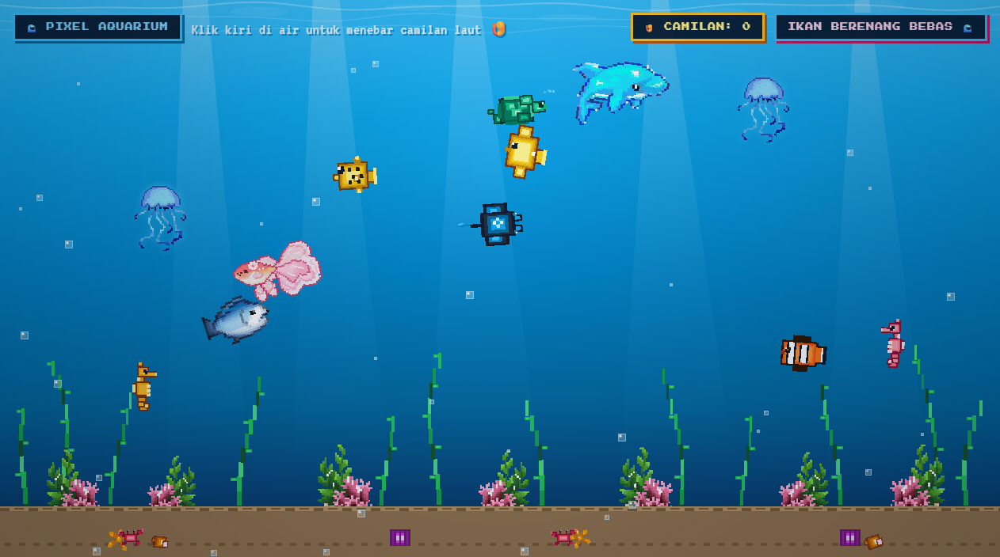

# 🌊 Pixel Aquarium - Interactive Underwater Ecosystem


Sebuah simulasi ekosistem laut interaktif berbasis **Pixel Art** retro yang dibangun secara native menggunakan **HTML5 Canvas**, **Vanilla JavaScript (ES6+)**, dan **CSS3**. Tanpa library atau framework eksternal (*zero external dependencies*).

---

## 📸 Preview



---

## ✨ Fitur Utama

### 🐠 Biota Laut & Spesies Beragam
- **Ikan Biru (Blue Tang)** & **Ikan Pink (Pink Betta)**: Memiliki animasi kibasan ekor & sirip (4-frame).
- **Ikan Badut (Clownfish)** & **Yellow Tang**: Berenang lincah di sela-sela karang.
- **Lumba-lumba (Dolphin)**: Berenang cepat melintasi layar secara anggun.
- **Pari Manta (Manta Ray)** & **Penyu Laut (Sea Turtle)**: Menjelajahi perairan dengan gerakan mengepak yang halus.
- **Kuda Laut (Seahorse)** & **Ikan Goby**: Menghuni bagian tengah dan dasar perairan.
- **Ubur-Ubur (Jellyfish)**: Bergerak naik-turun dengan denyutan bioluminescent khas.
- **Fauna Dasar Laut (Seabed)**: Kepiting kecil (*Mini Crab*) yang berjalan ke samping, kerang mutiara (*Pearl Clam*) yang membuka-tutup cangkang, bintang laut (*Starfish*), terumbu karang pastel, dan rumput laut (*Seaweed*) yang bergoyang dinamis mengikuti arus.

### 🎮 Interaktivitas & Mekanisme Game
- **Menebar Pakan / Camilan Laut (🍤)**: Klik kiri pada area akuarium untuk menjatuhkan pelet makanan.
- **AI Perilaku Ikan (Food Hunting & Flocking)**:
  - Ikan secara otomatis mendeteksi makanan terdekat dan berenang mengejarnya.
  - Memunculkan partikel hati (*Heart Particle*) dan efek teks melayang saat ikan berhasil memakan pakan.
- **Respon Terhadap Kursor (Cursor Tracking)**:
  - Ikan-ikan akan mendekat dan berenang mengikuti kursor mouse saat digerakkan.
  - Ikan akan kembali berenang santai (*idle swim*) jika kursor diam.
- **Retro Splash Screen**: Tampilan pembuka bergaya arcade retro 90-an lengkap dengan loading progress bar, animasi ikan berputar, serta tombol lewati (klik layar atau tekan spasi).

---

## 🛠️ Teknologi yang Digunakan

- **HTML5 Canvas**: Rendering grafis 2D berkecepatan tinggi dengan `imageSmoothingEnabled = false` untuk mempertahankan ketajaman pixel art.
- **Native SVG Pixel Art Engine**: Sprite digenerate secara programatik menggunakan koordinat matriks SVG dan dirasterisasi langsung ke canvas tanpa memerlukan file gambar eksternal yang berat.
- **Vanilla JavaScript (ES6+)**: Logika fisika pergerakan makhluk, sistem partikel (gelembung, riak air, pakan jatuh, reaksi emosi), dan state management.
- **CSS3 & Google Fonts**: Tipografi retro menggunakan font *Press Start 2P* dan *VT323* untuk nuansa arcade klasik.

---

## 🚀 Cara Menjalankan Proyek

Proyek ini sepenuhnya berbasis web native dan tidak membutuhkan instalasi dependensi atau build tool.

### 1. Buka Langsung di Browser
Cukup klik ganda file `index.html` di komputer Anda, atau buka file tersebut melalui browser (Google Chrome, Microsoft Edge, Mozilla Firefox, dll).

### 2. Menggunakan Live Server (VS Code / Extension)
Jika Anda menggunakan Visual Studio Code:
1. Buka folder proyek ini di VS Code.
2. Klik kanan pada file `index.html`.
3. Pilih **Open with Live Server**.

---

## 📁 Struktur File

```text
Aquarium-Pixel/
├── index.html                 # Halaman utama aplikasi & kanvas akuarium
├── style.css                  # Styling retro, HUD, dan splash screen
├── script.js                  # Logika ekosistem, fisika pergerakan, & AI biota
├── sprites.js                 # Data sprite dan modul visual
├── assets/                    # Aset grafis & SVG pendukung
└── README.md                  # Dokumentasi proyek
```

---

## 👤 Author & Kontributor

- **Nadia Miranti**
  - GitHub: [@Nadia-miranti](https://github.com/Nadia-miranti)
  - Repository: [Aquarium-Pixel](https://github.com/Nadia-miranti/Aquarium-Pixel)

---

## 📄 Lisensi

Proyek ini dibuat untuk keperluan eksplorasi kreatif dan pembelajaran pengembangan game/animasi web. Silakan digunakan dan dikembangkan!
